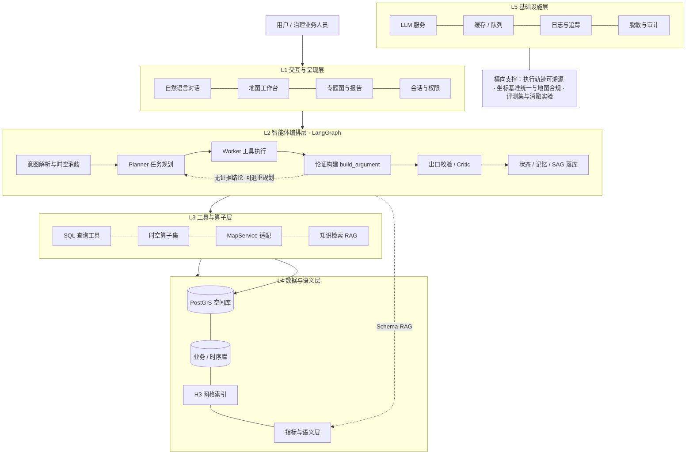

# 面向城市治理的时空智能体系统设计与实现

**研究与实现方案（毕设可执行版）**

> 版本：v1.3 · 2026-11-19
> v1.3 变更：SAG 升级为五构件（新增 Caveat，对标 Toulmin）；出口校验细化为 L1–L4 四级；新增 What-if 参数敏感性复算；指标区分「复算一致性」与「结论翻转率」；`src/argument/` 已实现并通过 56 项测试
> 技术基线（已锁定）：LangChain 1.0（`create_agent` / LangGraph 运行时 / middleware）、PostgreSQL 15+ / PostGIS 3.4+、MapService 可插拔适配层（默认高德，统一 GCJ-02）、主 LLM 云端 DeepSeek、前端 React + Vite
> **主攻方向**：空间结论的论证级可溯源（Spatial Argument Tracing / SAG）——整体够用即止，只把这一处做透

---

## 0. 先说结论：三个必须先定下来的判断

在展开方案之前，有三点会直接决定系统能不能跑起来、能不能通过答辩，建议先确认。

**判断一：技术基线应锁定 LangChain 1.0，而不是 0.x 教程里的写法。**
LangChain 1.0 已将 `create_agent()` 作为构建智能体的唯一标准入口，底层完全构建在 LangGraph 运行时之上；旧的 `initialize_agent`、`create_react_agent`、`LLMChain` 等已迁入 `langchain-classic` 兼容包。1.0 的核心扩展机制是 **middleware**（`before_agent` / `before_model` / `wrap_model_call` / `wrap_tool_call` / `after_model` / `after_agent` 六个钩子），并原生提供持久化 checkpoint、`thread_id` 会话隔离、结构化输出、流式与 human-in-the-loop。本方案所有设计都基于 1.0，避免开题后按旧教程返工。

**判断二：「接入谷歌地图」这一设想需要做合规替换，且正好可以变成论文的一个亮点。**
在城市治理（境内地理数据、政务场景）语境下，直接使用 Google Maps 存在三类硬问题，详见 §7.3：

| 问题 | 具体表现 |
| --- | --- |
| 资质与合规 | 境内地图服务须使用具备测绘资质的数据源，合规白名单为腾讯地图、高德、百度、天地图；Google Maps / Apple Maps / Bing 海外版 / Mapbox / Leaflet + 直连 OSM 境外瓦片均不在白名单内。境外底图还存在国界、台湾及南海诸岛标注不符合国家标准的风险。 |
| 坐标基准 | 国内合规底图与业务数据普遍使用 GCJ-02（或 BD-09），Google Maps 境外服务使用 WGS-84；不转换直接叠加会产生 300–600 m 系统性偏移，对网格级治理分析是致命的。 |
| 可用性与数据 | 境内 POI、路网、实时交通的覆盖与鲜度不足，且服务在境内访问不稳定，无法作为毕设演示的稳定依赖。 |

**已确定的做法（不推翻你的设想，而是把它升级一层抽象）**：把「地图能力」抽象为 **MapService 适配层**，工具语义继续对齐 Google Maps 的经典 API 划分（Geocoding / Places / Directions / Distance Matrix / Isochrone），具体 provider 做成可插拔；**默认 provider 定为高德地图**（后端走 Web 服务 REST，前端走 JS API 2.0），坐标统一 GCJ-02——高德全系输出 GCJ-02，与国内容易获取的业务数据和 PostGIS 库内几何天然一致，等于把偏移风险直接消除；Google Maps 仅保留为「境外区域对比实验」或接口语义参照，不进入主链路。数据库同步锁定 **PostgreSQL 15+ / PostGIS 3.4+**，一套库同时承载空间几何、业务台账与向量检索，减少组件与联调成本。这样你的「接入地图服务 + 工具化封装」设想完全保留，同时多出一个可写进论文的「多源地图服务适配与坐标基准统一」设计点，§7.4 给了完整适配器代码、前端示例与 Key 配置步骤。

**判断三：不要把系统做成「通用 NL2SQL 机器人」。**
通用大模型缺乏坐标概念，直接生成空间 SQL 极易出现坐标系错误、拓扑关系混淆、图层关联断裂，且结论不可溯源（这也是超图、中科星图等公开点出的行业痛点）。本方案把 LLM 的职责限定为 **意图理解、任务规划、参数编排、结果解释与校验**，把空间计算交给确定性的 PostGIS 算子与受控 SQL 模板。这一「LLM 负责推理、GIS 负责可计算与可溯源、Agent 负责编排」的分层，是国内外空间智能体的共识路线，也是本系统可信性的基础。

---

## 1. 研究背景、问题定义与定位

### 1.1 痛点

1. **交互门槛高**：空间查询依赖空间 SQL、GIS 算子参数、坐标转换，非 GIS 专业的城市管理人员难以独立完成复合分析。
2. **业务流程碎片化**：查询、空间分析、统计、制图、写报告分属不同工具，中间结果易丢失、流程不可复用。
3. **通用 LLM 空间推理失效**：不理解坐标系、拓扑、时序约束，输出无法落地验证，且存在幻觉。
4. **时空数据割裂**：静态矢量、业务台账、时序点位、POI/路网异构存储，缺少统一语义关联，自然语言无法跨源联合分析。

### 1.2 研究问题（可直接作为论文的研究目标）

- **RQ1**：如何把城市治理领域的自然语言问题，稳定地转换为「可校验、可复现、可溯源」的时空任务计划？
- **RQ2**：如何在 LangChain 智能体架构下，安全、可控地编排 SQL 数据库、空间算子与地图服务三类异构工具？
- **RQ3**：如何通过语义层、坐标基准统一与反思校验机制，抑制空间语义误判与结论幻觉？
- **RQ4**：如何构建面向城市治理场景的可量化评测集与指标体系，验证系统有效性？

### 1.3 与已有工作的关系（相关工作怎么写）

- **空间智能体 / GeoAI**：2025–2026 年业界提出「自然交互、自主思考、自动执行」的空间智能体范式，SuperMap GIS 2026 / AgentX Server、上海「量子城市 · 云宇星空」及系列政务智能体、高德千舆空间智能开放平台等均已落地；学术侧已有「五层解耦架构 + GeoFlow 工作流图 + Planner/Worker/Critic 多智能体 + Spatial-RAG + GIS 执行沙箱」的完整论述。
- **大模型 + 规划治理**：《城市规划》2026 年提出「技术融合—应用创新—范式重构」三阶段框架，强调 RAG、领域知识库、GIS 工具集成与人机协同。
- **NL2SQL / SQL Agent**：LangChain 生态中 `SQLDatabaseToolkit`（`sql_db_query` / `sql_db_schema` / `sql_db_list_tables` / `sql_db_query_checker`）已成熟；研究界共识是 schema linking / Schema-RAG、SQL lint（如 SQLGlot）、只读策略与查询校验是 demo 走向可用的关键。
- **本毕设定位**：不追求自研空间大模型，也不做通用 GIS 平台；聚焦**「面向 2–3 个具体治理场景的、以可溯源与可评测为特色的轻量化时空智能体原型」**，把工程闭环、评测方法与创新点做扎实即可达到毕设深度。

---

## 2. 典型城市治理场景

选择原则：**数据可得（可公开获取或合成）、工具链覆盖 SQL + 空间算子 + 地图服务三类中至少两类、结论有客观标准答案可评测**。

### 场景 S1（唯一主场景，纵深载体）：12345 热线 / 城管事件的时空态势研判与处置建议

- **自然语言示例**：「统计上周 XX 区占道经营类工单最集中的 5 个网格，对比上月变化，找出周边 500 m 内的处置力量，并给出派单建议。」
- **涉及数据**：事件工单表（类型、时间、位置、状态、处置单位）、行政区划/网格、处置资源点位、历史处置案例、路网。
- **工具链**：时间/空间约束抽取 → 参数化 SQL 聚合 → H3 网格聚类与热点识别 → 缓冲区/近邻查询（PostGIS） → 地理编码与路径时长（地图服务） → 相似案例 RAG → 报告生成。
- **可验证输出**：Top5 网格 ID 与工单数、环比变化、覆盖资源清单、建议派单单位；地图高亮热点网格与资源点；每条结论附带所用 SQL、算子与参数。

### 场景 S2（演示分支，只做一条最小路径）：公共服务设施可达性与服务盲区分析

- **自然语言示例**：「以 XX 街道为例，评估老年助餐点的 15 分钟步行覆盖情况，列出覆盖不足的社区，并推荐 3 处候选补点位置。」
- **涉及数据**：社区/网格人口（含老年人口）、设施 POI、路网与步行网络、行政区划、候选点位。
- **工具链**：指标语义层（「15 分钟生活圈」→ 步行 1200 m 等时圈）→ 地图服务步行路径/距离矩阵 → 覆盖叠加分析 → 人口加权缺口计算 → 候选点位近邻与评分 → 专题图。
- **可验证输出**：覆盖率、盲区社区清单及缺口人数、候选点排序与理由；地图叠加等时圈与盲区。

### 场景 S3（不本期实现，写入展望）：突发内涝/拥堵的影响范围推演与资源调度

- **自然语言示例**：「XX 路段发生内涝，列出周边 1 km 内受影响的小区、学校与易涝点，按距离给出最近的 3 支抢险队伍与预计到达时间。」
- **涉及数据**：事件点、易涝点、POI、路网、抢险队伍与物资点、历史灾情案例。
- **价值**：验证多步规划、失败重试、时序推演与 human-in-the-loop（调度建议需人工确认）。

### 明确「不做」的范围

实时视频/遥感解译、全市级真实政务数据接入、三维建模、多语言语音交互、自动下发工单/指令（写操作）、模型微调训练。这些放入「可扩展方向」而非本期实现。

---

## 3. 系统总体架构

采用 **五层纵向分层 + 横向支撑**，智能体编排层用 LangGraph 显式状态机（而非单个 ReAct 黑盒循环），保证流程可控、可中断、可回放。



### 各层职责与关键设计决策

| 层 | 职责 | 关键决策 |
| --- | --- | --- |
| L1 交互与呈现 | 对话入口、地图框选 AOI、专题图/热力图、结构化报告、权限 | 地图渲染只用合规底图；所有结论旁挂「依据」展开面板 |
| L2 智能体编排 | 意图解析、任务规划、工具调度、反思校验、记忆 | 用 LangGraph 显式图而非单 agent 循环；Planner 输出 **Pydantic 结构化计划**；`checkpointer` + `thread_id` 支持多轮追问 |
| L3 工具与算子 | SQL、空间算子、地图服务、RAG 四类工具的统一注册与沙箱执行 | 工具返回**结构化 JSON**（不是大段文本）；几何结果只回传摘要 + 图层 ID，避免撑爆上下文 |
| L4 数据与语义 | 空间库、业务库、网格索引、指标字典、知识库 | **H3 网格 ID 作为跨源统一空间主键**；语义层把业务术语映射为可参数化查询模板 |
| L5 基础设施 | 模型、缓存、追踪、脱敏 | LLM 可切换（云端 API / 本地 Qwen、DeepSeek）；LangSmith 或自研 trace 落库 |

横向贯穿三条线：**可溯源**（每个结论绑定 SQL、算子、参数、数据源版本）、**合规**（坐标基准、底图 provider、PII 脱敏）、**评测**（测试集、指标、消融）。这三条既是工程约束，也是论文的三大论据来源。

---

## 4. 核心功能模块

| 编号 | 模块 | 输入 → 输出 | 实现要点 |
| --- | --- | --- | --- |
| M1 | 时空语义解析器 | 自然语言 → `SpatialQuerySpec`（行政区、AOI、时间窗、指标、空间关系、阈值） | 规则 + LLM 结合；地理实体消歧走地名词典 + 地理编码；Pydantic 强制校验 |
| M2 | 指标与语义层 | 业务术语 → 表/字段/算子/默认参数 | YAML 定义指标字典、同义词、单位、坐标系、可用时间粒度；Schema-RAG 检索注入 |
| M3 | Planner 规划器 | `SpatialQuerySpec` → 结构化执行计划（有序步骤 DAG） | Geo-CoT 提示；模板优先，LLM 只填槽；计划可持久化复用 |
| M4 | 工具注册与执行器 | 计划步骤 → 工具调用结果 | `@tool` 定义；统一超时、重试、结果截断；`wrap_tool_call` 做守卫 |
| M5 | 受控 SQL 引擎 | 参数化模板 / 受控 SQL → 结果集 | 只读账号、表白名单、SELECT-only、强制 LIMIT、SQLGlot lint、EXPLAIN 代价预估 |
| M6 | 时空算子库 | 几何 + 参数 → 空间结果 | PostGIS `ST_Buffer` / `ST_Intersects` / `ST_DWithin` / `ST_ClusterDBSCAN` / `ST_Area`，H3 聚合；统一 SRID |
| M7 | MapService 适配层 | 地址/POI/路径/等时圈请求 → 标准化 JSON | **默认高德**（Web 服务 REST + JS API 2.0），Provider 可插拔、坐标统一 GCJ-02；结果缓存；失败降级到 PostGIS 近邻计算 |
| M8 | Critic 反思校验 | 工具结果 + 计划 → 通过 / 修正指令 | 语义一致性、数值范围、几何有效性、时间对齐、空结果、结论依据完整性；最多 3 轮自修正 |
| M9 | 呈现与报告 | 结构化结果 → 专题图 + 报告 + 依据清单 | 图层 ID 驱动前端渲染；Markdown/Word 报告；每条结论附 SQL 与参数 |
| M10 | 记忆与可观测 | 会话状态 → checkpoint / trace / 案例库 | `thread_id` 隔离；成功计划沉淀为模板；修正案例写入 RAG |
| **M11** | **论证构建器（主攻）** | 结论 + 工具结果 → **SAG 论证图** | `build_argument` 节点；Claim → Evidence → Operation → Provenance 四级建模；无证据结论直接拒绝并回退规划 |

---

## 5. 时空数据与业务数据组织方式

### 5.1 存储选型（毕设规模足够，且免费可复现）

| 用途 | 选型 | 说明 |
| --- | --- | --- |
| 空间 + 业务主库 | PostgreSQL 15+ / PostGIS 3.4+ | 一套库同时管几何与业务表，避免跨库 join；空间索引 GiST |
| 时序数据 | 主库分区表（或 TimescaleDB 可选） | 工单、流量、传感器按 `event_time` 月分区 |
| 向量/知识 | pgvector（与主库同实例） | 法规、预案、历史案例、指标说明、Schema 描述的嵌入检索 |
| 缓存 | Redis（可选，SQLite 亦可替代） | 地理编码结果、地图服务响应、热点查询 |
| 文件/图层 | 对象存储或本地 `data/` | GeoJSON、专题图、导出报告 |

### 5.2 坐标基准与空间主键（**这是最容易被忽略、答辩最容易被问的点**）

- **内部统一基准**：全部几何在入库时统一转换为 **GCJ-02（EPSG:4326 语义下的加密坐标，治理分析按经纬度计算时统一用同一基准）**；若涉及面积/距离精确计算，另存一份投影坐标（如 CGCS2000 / UTM 分带）几何列 `geom_proj`，距离与面积一律用投影列算，展示用经纬度列。
- **出图**：前端合规底图使用 GCJ-02，与库内一致，无需二次偏移；若引入任何 WGS-84 数据源（境外实验数据），必须在适配层显式转换并打标 `source_srid`。
- **H3 网格作为统一空间主键**：所有事件、POI、人口、设施、资源表都冗余一列 `h3_idx`（建议分辨率 8 / 9，约 0.7 km² / 0.1 km²），使「业务表 join 空间表」退化为等值 join，大幅降低 NL2SQL 难度，也让热点聚类、覆盖缺口计算可复用同一套逻辑。这是本方案在数据组织上的核心技巧。

### 5.3 核心表结构（DDL 摘要）

```sql
-- 行政区划与网格
CREATE TABLE dim_district (district_code text PRIMARY KEY, name text, geom geometry(MultiPolygon, 4326), geom_proj geometry);
CREATE TABLE dim_grid     (h3_idx text PRIMARY KEY, district_code text, center geometry(Point,4326), area_km2 numeric, population integer, elderly_pop integer);

-- 业务：事件工单
CREATE TABLE fact_event (
  event_id bigserial PRIMARY KEY,
  category text NOT NULL,           -- 占道经营 / 噪声 / 井盖 ...
  event_time timestamptz NOT NULL,
  status text,                      -- 待处置 / 处置中 / 已办结
  district_code text,
  h3_idx text,                      -- 统一空间主键
  geom geometry(Point, 4326),
  handling_unit text,
  close_hours numeric
);
CREATE INDEX ON fact_event USING gist (geom);
CREATE INDEX ON fact_event (h3_idx, event_time);

-- 空间基础：POI / 路网 / 处置资源
CREATE TABLE dim_poi      (poi_id text PRIMARY KEY, name text, category text, h3_idx text, geom geometry(Point,4326), source text);
CREATE TABLE dim_road     (road_id text PRIMARY KEY, name text, level text, geom geometry(LineString,4326));
CREATE TABLE dim_resource (res_id text PRIMARY KEY, name text, kind text, capacity int, h3_idx text, geom geometry(Point,4326));

-- 语义层元数据（供 Schema-RAG 与指标字典使用）
CREATE TABLE meta_metric   (metric_code text PRIMARY KEY, aliases text[], table_name text, expr text, unit text, default_window text, srid text, description text);
CREATE TABLE meta_table    (table_name text PRIMARY KEY, business_name text, description text, sample_values jsonb, sensitive_cols text[]);

-- 执行轨迹（可溯源）
CREATE TABLE agent_trace (
  trace_id uuid PRIMARY KEY, thread_id text, step_no int,
  plan_json jsonb, tool_name text, tool_args jsonb,
  sql_text text, row_count int, result_digest text,
  critic_verdict text, created_at timestamptz default now()
);
```

### 5.4 语义层 / 指标字典（YAML 示例）

```yaml
metrics:
  - code: event_hotspot
    aliases: [工单高发, 投诉集中, 热点网格]
    table: fact_event
    expr: "count(*)"
    group_by: h3_idx
    default_window: last_7_days
    description: 按 H3 网格统计事件数量，用于热点识别
  - code: walk_15min_coverage
    aliases: [15分钟生活圈, 步行可达覆盖, 服务覆盖率]
    params: {distance_m: 1200, mode: walking}
    pipeline: [map_isochrone, st_intersects, population_weighted_ratio]
    unit: percent
    description: 步行 1200 米等时圈覆盖的老年人口占比
```

**作用**：把「业务黑话」变成确定性的计算定义。LLM 只负责把问句映射到 `metric_code` 并填参数，不再自由生成 join 与聚合逻辑，SQL 正确率与可解释性同时提升。这一层是 §9 创新点 1 的落地点。

### 5.5 知识库（RAG）

四类语料，切分后入 pgvector：① 指标字典与表/字段描述（Schema-RAG）；② 城市治理法规、处置规范、预案；③ 历史典型案例（问题 → 计划 → 结论）；④ 空间算子说明与常见错误。检索结果在 `before_model` 阶段按相关性注入，控制 token 预算。

### 5.6 数据规模建议（毕设可复现）

数据分三类获取，**都要求可脚本复现**：① 行政区划与街道边界——天地图或民政部公开边界数据；② 路网与 POI——公开数据集（避免用地图 API 批量抓取后落库，服务条款对存储与再分发有限制），高德 API 只用于实时查询与短期缓存；③ 事件工单——**全合成**（3–5 个街道、约 200 个 H3 网格、5 万–20 万条、覆盖 12 个月），另配 300–800 个 POI、50 个资源点用于空间关联。合成脚本随代码提交，保证评测可复现——这一点在论文「实验设置」里很加分。

---

## 6. 智能体可调用的工具与任务流程

### 6.1 工具注册表（建议 12–15 个，够用且不稀释工具选择准确率）

| 分类 | 工具名 | 输入 → 输出 | 后端 | 读写 |
| --- | --- | --- | --- | --- |
| 语义 | `resolve_geo_entity` | 地名/地址 → 标准编码 + 几何 + `source_srid` | 地名词典 + 地理编码 | 读 |
| 语义 | `lookup_metric` | 业务术语 → `metric_code` + 参数定义 | 指标字典 / Schema-RAG | 读 |
| SQL | `query_events` | 时间窗 + 区域 + 类别 → 聚合结果 | 参数化模板 | 只读 |
| SQL | `query_grid_profile` | H3 列表 → 人口/设施画像 | 参数化模板 | 只读 |
| SQL | `run_safe_sql` | 受控 SELECT → 结果集（≤200 行） | SQLDatabase + 守卫 | 只读 |
| SQL | `inspect_schema` | 表名 → 字段/样例值 | `sql_db_schema` | 只读 |
| 空间 | `spatial_buffer` | 几何 + 距离 → 缓冲区图层 ID | PostGIS `ST_Buffer` | 读/临时 |
| 空间 | `spatial_nearest` | 点位 + 半径 + 类别 → 近邻列表 | `ST_DWithin` + KNN | 读 |
| 空间 | `grid_cluster` | 事件点集 → 热点网格 TopK | H3 聚合 / `ST_ClusterDBSCAN` | 读 |
| 空间 | `overlay_coverage` | 等时圈 + 人口网格 → 覆盖率/盲区 | `ST_Intersects` 叠加 | 读 |
| 地图 | `map_geocode` | 地址 → GCJ-02 坐标 + 置信度 | MapService 适配层 | 读 |
| 地图 | `map_search_poi` | 关键词 + AOI → POI 列表 | MapService 适配层 | 读 |
| 地图 | `map_route_matrix` | 起终点 + 出行方式 → 距离/时长 | MapService 适配层 | 读 |
| 地图 | `map_isochrone` | 中心点 + 时长/距离 → 等时圈几何 | MapService / 本地降级 | 读 |
| 知识 | `search_knowledge` | 问题 → 法规/预案/案例片段 | pgvector RAG | 读 |
| 输出 | `render_layer` | 图层 ID + 样式 → 前端图层配置 | 呈现层 | 读 |
| 输出 | `compose_report` | 结构化结论 + 依据 → 报告 | 模板引擎 | 写文件 |

**约定**：几何/大结果不直接进 LLM 上下文，工具只回传 `layer_id`、统计摘要、TopK 列表与行数；完整数据落在临时表/文件，前端按需拉取。

### 6.2 LangGraph 状态机流程

```
[用户输入]
   ↓  M1 时空语义解析（resolve_geo_entity + lookup_metric）
[SpatialQuerySpec]
   ↓  M3 Planner（Geo-CoT → Pydantic 结构化计划，标注依赖）
[ExecutionPlan: 有序步骤 DAG]
   ↓  M4 Worker 逐步执行（SQL / 空间算子 / 地图服务 / RAG）
[ToolResults: 结构化 JSON + layer_ids]
   ↓  M11 论证构建 build_argument（Claim → Evidence → Operation → Provenance）
[SAG 论证图 + 候选结论]
   ↓  M8 出口校验（no-evidence-no-claim：无法落到 Evidence 的结论直接拒绝）
   ├─ 拒绝或失败 → 回退 Planner 修正（≤2 轮）
   ↓ 通过
[M9 呈现：地图图层 + 论证面板 + 报告]
   ↓  M10 SAG 与轨迹落库（支持复算）
[最终答案]
```

**关键差异**：论证构建是**独立节点**，不是塞在 Critic 里的一段提示词。它把「结论必须可溯源」变成图结构上的硬约束——这是本方案与常规 Agent 实现最本质的区别。

状态对象建议：

```python
class AgentState(TypedDict):
    messages: list
    query_spec: dict | None          # 时空约束
    plan: list[PlanStep] | None      # 结构化计划
    tool_results: dict               # step_id -> 结构化结果
    layer_ids: list[str]             # 待渲染图层
    claims: list[Claim]              # 候选结论
    sag: SAG | None                  # 论证图（Claim/Evidence/Operation/Provenance）
    rejected_claims: list[str]       # 因无证据被拒的结论（用于消融统计）
    critic_feedback: str | None
    retry_count: int
```

### 6.3 一次完整调用轨迹（S1 示例，可直接做答辩演示）

> 用户：「上周 XX 区占道经营工单最集中的 5 个网格，对比上月，找周边 500 m 内的处置力量并给派单建议」

| 步 | 动作 | 工具/产物 |
| --- | --- | --- |
| 1 | 解析出 行政区=XX区、时间窗=上周/上月、类别=占道经营、指标=event_hotspot、TopK=5、半径=500 m | `resolve_geo_entity` + `lookup_metric` |
| 2 | 计划：① 双时间窗网格聚合 ② 环比计算 ③ 热点网格中心点 ④ 500 m 近邻资源 ⑤ 步行时长 ⑥ 相似案例 ⑦ 报告 | Pydantic `ExecutionPlan` |
| 3 | 执行 ①：`query_events` 参数化 SQL（只读、LIMIT、H3 group by） | 结果：10 行网格聚合 |
| 4 | 执行 ③–⑤：`spatial_nearest` + `map_route_matrix` | 资源清单 + 到达时长 |
| 5 | 执行 ⑥：`search_knowledge` 返回历史处置规范 | 案例片段 |
| 6 | Critic：校验环比分母非零、网格均属 XX 区、资源点 SRID 一致、每条结论均有 evidence | 通过 |
| 7 | 输出：Top5 表格 + 环比 + 派单建议 + 地图高亮 + 展开可见的 SQL 与参数 | `render_layer` + `compose_report` |
| 8 | 轨迹写入 `agent_trace`，`thread_id` 支持追问「把半径改成 800 m 再算一次」 | checkpoint |

**失败自修正示例**：若 `run_safe_sql` 因「未知列」报错，`ToolErrorMiddleware` 把错误回传模型，`inspect_schema` 重新取字段后重写；若 Critic 发现等时圈 SRID 不一致，自动插入坐标转换步骤重跑。所有修正都记入轨迹，作为「可溯源 + 自修正」的实验证据。

---

## 7. LangChain 与 SQL / 地图的集成思路

### 7.1 版本与依赖

```
langchain>=1.0            # create_agent / middleware / structured output
langchain-community       # SQLDatabase, SQLDatabaseToolkit
langgraph                 # 显式状态机、checkpointer
langchain-openai / langchain-deepseek / langchain-ollama   # 模型适配（可切换）
sqlglot                   # SQL 解析与 lint
psycopg[binary]           # PostgreSQL
pydantic>=2               # 结构化输出与状态校验
h3, shapely, geoalchemy2  # 网格与几何
```

### 7.2 智能体装配（示意）

```python
from langchain.agents import create_agent
from langchain.agents.middleware import (
    SummarizationMiddleware, HumanInTheLoopMiddleware, PIIMiddleware,
    ToolRetryMiddleware, ModelCallLimitMiddleware,
)
from langgraph.checkpoint.postgres import PostgresSaver

agent = create_agent(
    model="deepseek:deepseek-chat",          # 可通过 init_chat_model 切换
    tools=TOOL_REGISTRY,                     # §6.1 全部工具
    system_prompt=GOV_SYSTEM_PROMPT,
    response_format=SpatialQuerySpec,        # 1.0 主循环内结构化输出
    checkpointer=PostgresSaver(conn),        # thread_id 会话隔离
    middleware=[
        PIIMiddleware(...),                  # 工单中的手机号/地址脱敏
        SqlGuardMiddleware(),                # 自定义：wrap_tool_call 守卫（见下）
        ToolRetryMiddleware(...),            # 工具失败指数退避重试
        ModelCallLimitMiddleware(...),       # 防止循环失控
        SummarizationMiddleware(...),        # 长会话压缩
        HumanInTheLoopMiddleware(interrupt_on={"compose_report": ...}),  # 调度建议人工确认
    ],
)
```

复杂任务（S1/S3）不直接用 `create_agent` 的单循环，而是用 **LangGraph 显式图**：`parse → plan → execute → critic → (修正回环) → render`，每个节点内部再复用 `create_agent` 装配的 Worker。这样兼顾 1.0 的开箱能力与流程可控性。

### 7.3 SQL 集成：三层受控方案（**不要裸 NL2SQL**）

**第 1 层 · 语义层收敛**：`lookup_metric` 把业务术语映射到 `metric_code`，多数查询直接命中**参数化查询模板**（Jinja/SQL 模板 + 绑定变量），LLM 完全不写 SQL。

```sql
-- templates/event_hotspot.sql.j2
SELECT h3_idx, count(*) AS cnt
FROM fact_event
WHERE event_time BETWEEN :start AND :end
  AND district_code = ANY(:district_codes)
  AND category = :category
GROUP BY h3_idx ORDER BY cnt DESC LIMIT :topk;
```

**第 2 层 · 受控生成**：模板无法覆盖时才允许生成 SQL，但只允许在语义层暴露的**视图 / 物化视图**子集上做 SELECT，禁止碰基表敏感列；注入 `inspect_schema` 返回的字段描述与样例值（Schema-RAG），并强制 `LIMIT`。

**第 3 层 · 执行守卫**：自定义 middleware 在 `wrap_tool_call` 中拦截所有 SQL 工具调用。

```python
from langchain.agents.middleware import createMiddleware, wrap_tool_call

@wrap_tool_call
async def sql_guard(request, handler):
    if request.tool_call["name"] in SQL_TOOLS:
        sql = request.tool_call["args"]["query"]
        ast = sqlglot.parse_one(sql, read="postgres")
        assert isinstance(ast, sqlglot.exp.Select), "仅允许 SELECT"
        assert not any(k in sql.upper() for k in ("DROP","DELETE","UPDATE","INSERT","ALTER",";"))
        assert set(sqlglot.find_all_tables(sql)) <= ALLOWED_VIEWS, "表不在白名单"
        assert "LIMIT" in sql.upper(), "缺少 LIMIT"
        # EXPLAIN 代价预估、行数上限、执行超时在 SQLDatabase 层兜底
        request.tool_call["args"]["query"] = ast.sql(dialect="postgres")
    return await handler(request)

SqlGuardMiddleware = createMiddleware(wrap_tool_call=sql_guard)
```

数据库侧再加一道：**只读账号** + `statement_timeout` + `idle_in_transaction_session_timeout`。三层叠加形成「生成—校验—执行」纵深防御，可直接写进论文的安全设计章节。

> 备注：`SQLDatabaseToolkit` 的 `sql_db_query_checker` 可作为第 3 层的补充（LLM 自检），但**不能替代**确定性 lint。

### 7.4 地图集成：MapService 适配层（默认 provider：高德）

**接口设计**（语义对齐经典地图 API，provider 无关；返回值统一 GCJ-02）：

```python
class MapService(Protocol):
    def geocode(self, address: str) -> GeoResult: ...        # 统一返回 GCJ-02
    def search_poi(self, keyword: str, aoi: Polygon, limit: int) -> list[POI]: ...
    def route_matrix(self, origins: list[Point], dests: list[Point],
                     mode: Literal["walking","driving"]) -> list[Route]: ...
    def district_boundary(self, name: str) -> MultiPolygon: ...
    def isochrone(self, center: Point, minutes: int, mode: str) -> Polygon: ...

class AmapProvider(MapService):
    """默认 provider：高德开放平台 Web 服务（REST），坐标基准 GCJ-02，与库内几何一致。"""
    ...

class OverseasCompareProvider(MapService):
    """可选：仅用于境外区域对比实验，输出前必须标注并转换 SRID。"""
    ...
```

**AmapProvider 实现要点**（`httpx` + 缓存 + 重试，key 只从环境变量读取）：

```python
import httpx
from tenacity import retry, stop_after_attempt, wait_exponential

AMAP = "https://restapi.amap.com/v3"

class AmapProvider:
    def __init__(self, key: str, cache):
        self.key, self.cache = key, cache          # key 来自 os.environ["AMAP_WEB_KEY"]
        self.client = httpx.Client(timeout=5.0)

    @retry(stop=stop_after_attempt(3), wait=wait_exponential(min=0.3, max=2))
    def _get(self, path: str, **params) -> dict:
        r = self.client.get(f"{AMAP}/{path}", params={**params, "key": self.key})
        r.raise_for_status()
        data = r.json()
        if data.get("status") != "1":              # 高德用 status=1 表示成功
            raise MapServiceError(data.get("info"), data.get("infocode"))
        return data

    def geocode(self, address: str) -> GeoResult:
        # GET /geocode/geo?address=...&city=...  → geocodes[0].location "lon,lat"
        ...

    def search_poi(self, keyword, aoi, limit=20) -> list[POI]:
        # GET /place/text?keywords=...&city=...&citylimit=true&extensions=base
        ...

    def route_matrix(self, origins, dests, mode="driving") -> list[Route]:
        # 高德为一对一规划（/direction/driving | /direction/walking），无批量矩阵接口：
        # 先用 /distance 直线距离排序，再对 TopK 求真实路径，控制配额
        ...

    def district_boundary(self, name: str) -> MultiPolygon:
        # GET /config/district?keywords=...&subdistrict=0&extensions=all → polyline
        ...

    def isochrone(self, center, minutes, mode) -> Polygon:
        # 高德无等时圈 REST 接口：路网节点采样 + 批量路径时长 → 等值点拟合；
        # 采样失败时降级为 ST_Buffer 圆 + 路网可达性过滤
        ...
```

**为什么这样设计**（论文与答辩可直接引用）：

1. **合规**：城市治理场景的地图服务应使用具备测绘资质的数据源，合规白名单为高德、腾讯、百度、天地图；Google Maps、Apple Maps、Bing 海外版、Mapbox、Leaflet + 直连 OSM 境外瓦片等不属于合规来源，且境外底图在国界、台湾及南海诸岛标注上存在不符合国家标准的风险。
2. **坐标**：国内底图与业务数据为 GCJ-02 / BD-09，Google Maps 境外服务为 WGS-84，未转换叠加会偏移数百米，网格级分析结论无效。适配层在入口统一做 `source_srid → GCJ-02` 转换并打标。
3. **工程**：加一层缓存与降级（地图服务不可用时用 PostGIS `ST_DWithin` 近邻 + 路网距离兜底），保证毕设演示不依赖外部网络。
4. **基准一致性（选高德的实际收益）**：高德 Web 服务与 JS API 全系输出 GCJ-02，与国内业务数据、PostGIS 库内几何天然一致，适配层无需做坐标转换，只保留 `source_srid` 标记用于校验外部 WGS-84 数据。这一条可直接写进论文的「坐标基准统一」小节——**不是增加了转换工作量，而是消除了偏移风险**。

**前端渲染**（高德 JS API 2.0；key 与安全密钥均为显式占位符，不含任何可用密钥）：

```html
<script>
  window._AMapSecurityConfig = {
    securityJsCode: '请在高德开放平台控制台获取安全密钥并替换此占位符'
  };
</script>
<script src="https://webapi.amap.com/maps?v=2.0&key=请在高德开放平台申请Web端(JS API)的key并替换此占位符"></script>
<script>
  const map = new AMap.Map('container', {
    zoom: 12,
    center: [116.397428, 39.90923],
    viewMode: '2D'
  });
  AMap.plugin(['AMap.PlaceSearch', 'AMap.Geocoder', 'AMap.Driving', 'AMap.Walking'], () => {
    // 检索 / 地理编码 / 路径规划使用插件实例，不要手工拼接 REST URL
  });
</script>
```

**Key 申请与配置（三步）**：

1. 入口：高德开放平台（lbs.amap.com）→ 控制台 → 应用管理 → 创建新应用 → 添加 Key。
2. **按用途分别申请两个 Key，不要混用**：
   - 「Web服务」Key：后端 `AmapProvider` 调 REST 接口用，可配 IP 白名单；
   - 「Web端(JS API)」Key：前端地图渲染用，必须配域名白名单（本地开发填 `localhost`）。
3. 新版 Key 强制安全密钥：控制台复制 `securityJsCode`，按上面代码注入 `window._AMapSecurityConfig`；正式环境应由后端代理签名（`jscode` 参数），避免密钥进入前端明文。**任何情况下都不要把可用 Key 写进代码或提交到仓库**，统一走 `.env` + `.env.example` 占位。

> **三个必须提前知道的坑**：① 高德**没有等时圈 REST 接口**，`isochrone()` 只能用路径规划采样近似或降级为缓冲区 + 路网可达性，论文里要写明近似方法与误差；② 个人开发者 Key 有 QPS 与日调用量限制，地理编码/路径规划必须加缓存与批量策略，跑评测批时更要控速；③ 地图服务条款对 POI 数据的存储与再分发有限制，长期演示数据不要靠 API 批量抓取入库，改用公开数据集或天地图，API 只做实时查询与短期缓存。批量点位还须遵守个人信息保护要求，个人轨迹只在本地私有存储。

### 7.5 结构化输出、记忆与可观测

- **结构化输出**：`response_format=SpatialQuerySpec`（Pydantic）在 1.0 主循环内生成，省一次额外模型调用；解析失败由 `handle_errors` 策略兜底。
- **记忆**：`checkpointer` + `thread_id` 实现多轮追问（「把半径改成 800 m」）；`SummarizationMiddleware` 控制长会话；成功的 `ExecutionPlan` 沉淀为可复用模板。
- **可观测**：LangSmith 或自研 `agent_trace` 表，记录每次模型调用、工具参数、SQL、行数、耗时、Critic 判定、修正轮次；既是调试工具，也是论文实验数据来源。

---

## 8. 关键技术难点与对策

| # | 难点 | 后果 | 对策 |
| --- | --- | --- | --- |
| D1 | 时空实体与指标歧义（「片区」指行政区还是网格、「附近」多少米） | 计划错、结论错 | 地名/指标词典 + 地理编码 + Pydantic 强校验 + 缺失约束主动反问（HITL） |
| D2 | NL2SQL 不可靠、幻觉列名、错误 join | 查询失败或静默出错 | 语义层 + 参数化模板为主、受控生成为辅、SQLGlot lint、只读账号、Critic 数值校验 |
| D3 | 坐标系与尺度不一致 | 叠加偏移、面积/距离错误 | 统一 GCJ-02 展示列 + 投影计算列；适配层打标 `source_srid`；入库强校验 SRID |
| D4 | LLM 无坐标概念导致空间关系误判 | 编造「相邻/覆盖」结论 | 空间关系一律由 PostGIS 算子计算，LLM 只解释结果；结论必须挂 evidence |
| D5 | 多步任务的状态与错误恢复 | 中间结果丢失、流程不可复现 | LangGraph 显式状态 + checkpoint；Critic 回环 ≤3 轮；计划与轨迹持久化 |
| D6 | 几何/大结果撑爆上下文、时延高 | token 暴涨、响应慢 | 工具只回摘要 + `layer_id`；结果截断；`ContextEditingMiddleware`；缓存与物化视图 |
| D7 | 地图服务不稳定 / 配额 / 合规 | 演示失败、答辩风险 | 适配层缓存 + PostGIS 降级 + 合规 provider（§7.4） |
| D8 | 缺少客观评测标准 | 「看起来能用」但论文说服力不足 | 自建标注测试集 + 可计算指标 + 消融实验 + 基线对比（§12） |
| D9 | 隐私与数据安全 | 工单含个人信息 | `PIIMiddleware` 脱敏、敏感列白名单、轨迹审计、只读权限、数据本地化 |

---

## 9. 主攻方向与创新点（单点纵深）

### 9.0 取舍原则

整体系统按「够用即止」实现：1 个主场景闭环、6–8 个最小工具集、常规地图工作台、能跑通评测即可。把 60% 以上的精力压在**一个可形式化、可量化、别人不易复制**的点上，其余部分只保证「能支撑这个点被验证」。

这个取舍对毕设是必要的：评审看的不是功能数量，而是「有没有一个说得清、证得明的贡献」。

### 9.1 主攻方向：空间结论的「论证级可溯源」（Spatial Argument Tracing）

**一句话**：让智能体给出的每一条空间结论，都能被还原成一张「结论—证据—算子—数据」的论证图，并支持一键复算。

**为什么是这个角度（gap 论证，开题可直接用）**

| 现有路线 | 它们做到了什么 | 缺了什么 |
| --- | --- | --- |
| GIS / 空间智能体（AgentX、GeoGPT、各类地图 Agent） | 自然语言 → 地图 + 文字结论 | 中间空间推理过程不显式建模，用户只能选择信或不信 |
| Text-to-SQL 可溯源 | 记录 SQL 文本与执行结果 | 不追空间算子、几何对象、参数与坐标基准 |
| 可解释 AI（XAI） | 特征归因、注意力可视化 | 与空间证据无关，无法回答「这个结论凭什么」 |

→ **交叉空白：空间结论的论证结构本身，没有被当作一等对象（first-class object）建模。** 这就是能做出独特成果的缝隙，而且它天然属于「城市治理」语境——政务结论必须可审计、可复核。

**三个独特构件（方法层 / 机制层 / 呈现层，缺一不可）**

**① SAG 空间论证图数据模型（方法层）：五构件 + Toulmin 映射**

```
Claim(结论) ──derived_from──> Evidence(空间证据) ──computed_by──> Operation(算子/参数)
   │                                                                     │
   └──qualified_by──> Caveat(限定条件)                          sourced_from
                                                                         v
                                                            Provenance(数据源/时间窗/SRID/版本)
```

与 Toulmin 论证模型的对应关系（论文第 4 章可直接引用）：

| SAG 构件 | Toulmin 要素 | 职责 |
| --- | --- | --- |
| Claim | Claim（主张） | 自然语言结论，附可校验的结构化数值与实体 |
| Evidence | Data / Grounds（论据） | 四类限定证据，绑定图层与结果摘要 digest |
| Operation | Warrant（正当理由） | 可执行算子、参数与可调区间 |
| Provenance | Backing（支撑） | 数据源、时间窗、坐标基准、数据版本 |
| Caveat | Qualifier + Rebuttal（限定词与反驳条件） | 降级、小样本、近似、参数边界、坐标基准差异 |

> 表述注意：Toulmin 中 Qualifier 与 Rebuttal 是两个独立要素，本模型将其合并为 `Caveat.kind` 的一个维度。论文须写明这是**工程化合并**，不能声称理论等价——否则懂行的评委会在此追问。

Evidence 限定四类，避免建模发散：
- **网格聚合**：`h3_idx` + 统计量（计数、密度、环比）
- **几何覆盖**：缓冲区 / 等时圈 / 交集面积 / 覆盖人口
- **点集**：参与计算的具体点位（TopK 资源、事件点）
- **参照对比**：基期、同类区域、全市均值

两条模型级约束：每条 Claim 至少挂 1 条 Evidence；每条 Evidence 必须落到可执行的 Operation，否则该 Evidence 不合法。**第三条容易被忽略但最关键**：Claim 中的每个数值都要声明来源——`raw`（直取字段）、`derived`（给公式与因子，系统重算）、`external`（实时接口，无法本地复算则降级为警告）。没有这一条，"证据存在"与"数值为真"就混成了一件事。

**② 分层硬校验（机制层）—— 最能体现「不是靠提示词」的地方**

在 LangGraph 里增加 `build_argument` 节点，出口做四级校验，任一级不通过即判不合格、回退重规划（计入 Critic 轮次）：

| 层级 | 校验内容 | 拦住什么 |
| --- | --- | --- |
| L1 结构 | 证据存在、Operation 可执行 | 没有证据的结论 |
| L2 绑定 | 数值能在证据中找到出处；派生值按公式重算；**派生因子同样要可追溯** | 挂着合法证据编数字 |
| L3 语义 | 方向词（上升/下降）与变化量指标符号一致 | 数字对但把话说反了 |
| L4 限定 | Caveat 双向核对：该声明的没声明、或声明了规则不支撑的 | 无标注的降级结论、编造限定条件 |

两个设计细节值得写进论文：

- **派生值的处理是这套校验能否落地的分水岭。** 结论里的百分比、占比、均值都不是原始字段值。若按"数值是否出现在证据中"判断，12.5% 这类正确结论会被判为幻觉——系统一上线就大面积误杀。必须允许派生，但派生必须给公式与因子。
- **允许派生而不校验因子，等于开了更大的后门**：因子随便填，公式能算出任意结果。因此因子值同样要在绑定证据的数值域中有出处。
- **Caveat 必须由规则自动生成**，不能由模型自述：降级标记来自 Operation 的 fallback 链，小样本来自 `sample_size < 5`，近似来自算子的误差界声明，参数边界来自可调区间端点。否则它只是又一句修辞。

把「可溯源」从「最好有」变成「结构上不可能没有」——这是本方向与「让模型自己引用来源」类工作的本质区别。

**③ 论证面板与 What-if 复算（呈现层）**

点一条结论 → 高亮其证据图层（网格 / 缓冲区 / 点集） → 展开算子参数 → 一键复算并比对 digest。

复算要区分两种，不能混为一谈（这是答辩高频追问点）：

| 类型 | 做什么 | 检验什么 |
| --- | --- | --- |
| 复算一致性 | 同一 Operation、同一参数重复执行，digest 是否稳定 | LLM 结论改写、实时地图接口抖动、缓存差异 |
| 参数敏感性 | 拖动空间参数（如 500 m → 800 m）重跑，看结论是否翻转 | 结论对参数是否稳健 |

> 只做"重跑同一条 SQL"是没有说服力的：静态数据 + 确定性 PostGIS 必然一致，评委会直接问"这算什么实验指标"。真正的价值在于——一致性指标暴露的是**智能体非确定性**，敏感性指标暴露的是**结论稳健性**，两者都有实验可做。

**可量化指标**

| 指标 | 定义 | 目标 |
| --- | --- | --- |
| 证据完整率 | Claim 有 ≥1 条可落地 Evidence 的比例 | 100% |
| 必需证据命中率 | 结论所需的关键证据是否被实际调用 | ≥85% |
| 证据充分性 | 人工 5 分制评分（3 人，报一致性） | ≥4.0 |
| 复算一致率 | 同一问题多次独立运行，结论 digest 稳定率 | ≥95% |
| 结论翻转率 | 参数改动后结论翻转的比例（敏感度，报告不设阈值） | 观察量 |
| 幻觉率 | 无证据、数值矛盾或方向冲突的结论占比 | ≤3% |
| 消融增益 | 去掉 `build_argument` 后上述指标的变化 | 显著下降 |

外加一个小规模理解度实验（10–15 人，有/无论证面板对比），支撑「可解释性有效」这一主张。

### 9.2 三个支撑性设计（降级为「够用即止」，不单独主张创新）

原方案的三个创新点保留为实现手段，但论文里只作为「系统设计」章节内容，**不作为创新点主张**——避免创新点分散、答辩被追问「到底创新在哪」。

| 原创新点 | 在本方案中的角色 | 简化到什么程度 |
| --- | --- | --- |
| NL2Plan + 指标语义层 | 保证 SAG 的 Operation 可落地、可执行（否则证据无法复算） | 只做 S1 涉及的 8–12 个指标，不做通用语义层 |
| Planner / Critic 反思 | SAG 构建器天然承担大部分校验；Critic 只保留数值一致、几何有效两类检查 | 回环 2 轮，不做复杂策略 |
| MapService + 坐标基准契约 | 保证 Evidence 的 Provenance 中 SRID 可信 | 只实现高德 + 一个 Mock provider |

**一句话总结这个方向**：不追求「什么都能问」，而是追求「问出来的每一句都能被验证」。

### 9.3 附注：坐标基准为什么不能当创新点讲（但必须做对）

MapService 与坐标基准是本方案必须做对的基础设施，但**不建议作为创新点主张**。高德 Web 服务与 JS API 全系输出 GCJ-02，与库内几何本就一致——如果按「provider 之间的坐标转换」立论，答辩时一句「那你到底转了啥」就会被问住。

正确做法是把它写成**工程约束**而非贡献：任何数据源进入系统必须声明 `source_srid`，适配层负责转换与校验，PostGIS 内部区分「展示列（GCJ-02）」与「计算列（投影）」。它的价值体现在 SAG 的 Provenance 节点上——**SRID 是证据可信的前提**，而不是单独的卖点。

验证方式放在系统测试而非实验章节：引入一份 WGS-84 模拟 GPS 数据，对比直接叠加（偏移 300–600 m）与经适配层转换（≤50 m）；跨 provider 同一 POI 检索一致性；服务不可用时的降级成功率。

> 整篇论文的贡献收敛成一句：**让空间结论可被论证、可被复算**。其余都是为这句话服务的基础设施。

---

## 10. 适合毕设落地的范围（纵深 / 支撑 / 不做）

| 层级 | 内容 | 精力分配 |
| --- | --- | --- |
| **纵深层（主攻，必须做透）** | SAG 论证图数据模型；`build_argument` 节点与 no-evidence-no-claim 硬约束；证据完整率/充分性/复算一致率/幻觉率四项指标；消融实验；论证面板与一键复算；小规模理解度实验 | **60%** |
| **支撑层（最小实现，够用即止）** | S1 单场景闭环（事件热点研判 + 派单建议）；6–8 个工具；8–12 个指标；Planner + 2 类 Critic 检查；高德适配 + Mock provider；React 单页工作台（地图 + 对话 + 论证面板）；100 条评测集 | **30%** |
| **不做（写入展望）** | S2/S3 完整实现（仅留一条 S2 演示分支）；12–15 个工具；通用语义层；多 provider 热切换；实时流处理；多模态；自动派单写操作；全市真实政务数据；遥感解译与三维 | **10%** |

**一句话边界**：**一个场景做到底，一个角度做到透。** 场景只是载体，SAG 才是产出——场景换了不影响方法成立，这才是能写进论文的贡献。

---

## 11. 分阶段开发计划（18 周）

| 阶段 | 周次 | 目标与任务 | 产出 | 里程碑 / 验收 |
| --- | --- | --- | --- | --- |
| P0 调研与开题 | 1–2 | 文献调研（空间智能体、GeoAI、可解释与可溯源、LangChain 1.0）、**确定 SAG 论证图模型与四项指标**、场景与需求定义、技术选型验证 | 开题报告、文献综述、SAG 模型定义、技术选型报告 | 本地跑通 `create_agent` + PostGIS 查询 + 高德调用；SAG 字段定稿 |
| P1 数据底座 | 3–6 | 建库建表（含 `sag_claim` / `sag_evidence` / `sag_operation` / `sag_provenance` 四表）、坐标基准规范、H3 网格、合成数据脚本、8–12 个指标字典、MapService（高德 + Mock） | DDL、数据脚本、指标字典、适配层单测 | S1 数据可查；跨源 H3 join 跑通；证据表可写入并回读；高德 Key 与缓存策略验证 |
| P2 工具层与基线 | 7–10 | `@tool` 实现 **6–8 个工具**（只覆盖 S1：事件聚合、网格画像、缓冲区、近邻、H3 热点、地理编码、POI 检索、RAG）、参数化 SQL 模板、`SqlGuardMiddleware`；搭**单 ReAct 基线**用于对照 | 工具注册表、守卫中间件、基线 A0 | 工具单测通过；守卫能拦 DROP / 无限结果 / 越权表；基线可答简单问句 |
| P3 智能体闭环（**重心**） | 11–14 | LangGraph 六节点（parse / plan / execute / **build_argument** / critic / render）、SAG 落库、no-evidence-no-claim 出口校验、React 地图工作台 + **论证面板 + 一键复算**、checkpointer 多轮 | 完整系统、论证面板、SAG 可视化 | S1 端到端跑通；无证据的结论被系统拒绝；点结论能高亮证据图层并复算成功 |
| P4 评测与优化 | 15–16 | 100 条标注集（L1 40 / L2 40 / L3 20）、四项 SAG 指标、人工证据充分性评分（3 人）、**消融：去 `build_argument` / 去 Operation 落地校验**、理解度实验（10–15 人）、慢查询优化 | 评测报告、消融图、理解度结果 | 指标达标（§12）；消融差异显著；P95 时延达标 |
| P5 论文与答辩 | 17–18 | 论文撰写（含架构图、实验表、消融图）、系统演示脚本与录屏、答辩 PPT | 毕业论文、演示材料、代码归档 | 预答辩通过；代码与数据脚本可一键复现 |

**风险缓冲**：P1 的数据获取与 P3 的地图服务联调最易延期，建议各预留 1 周；P2 的基线系统务必保留，它是 P4 对比实验的前提，不要中途删掉。

---

## 12. 重点验证功能与评测方案

### 12.1 重点验证功能（演示优先级从高到低）

1. **论证面板（主攻，放第一位）**：问一句 → 得到结论 → 点结论高亮证据图层（网格 / 缓冲区 / 点集）→ 展开算子与参数 → 点「复算」比对 digest 一致。
2. **no-evidence-no-claim**：故意问一个数据不支持的问题（例如「XX 区上周噪声投诉下降多少」而该区无记录），观察系统拒绝下结论、说明缺什么，而不是编造。
3. **S1 完整闭环**：自然语言 → 计划 → 多工具执行 → 论证构建 → 地图 + 报告。
4. **证据消融对照**：同一问句在 A0（有 `build_argument`）与 A1（无）下的输出并排展示，现场看到 A1 出现无依据结论。
5. **多轮追问与 What-if 复算**：先说「把半径改成 800 m」，验证证据随参数**重建**（旧证据失效、新证据生成），而不是只改文字；再在论证面板拖动时间窗滑块（7 天 → 14 天），系统重跑算子并即时提示「Top1 网格未变 / 已翻转」。**这是本方案最有画面感的演示**，也直接回应「静态数据复算没意义」的质疑。
6. **确定性校验拦截「虚假绑定」**：现场让模型生成一条挂着合法证据但数值写错的结论，展示被 L2 绑定层拦下并回退重规划；再展示一条「数值对但说成下降」的结论被 L3 方向层拦下。
7. **安全与合规**：SQL 守卫拦截 DELETE / 无限结果 / 越权表；坐标基准契约展示 WGS-84 叠加偏移。

### 12.2 测试集

**100 条人工标注 + 10 条不可回答探针，共 110 条用例**。前三档衡量「答得对不对」，U 组衡量「该不该答」：

| 档位 | 数量 | 类型 | 标注内容 |
| --- | --- | --- | --- |
| L1 简单 | 40 | 单表 / 单指标、明确时空 | 标准数值 + 应调用工具 |
| L2 中等 | 40 | 多表 join + 空间算子 | 标准数值 + 工具序列 + **必需证据** |
| L3 复杂 | 20 | 多步规划 + 地图服务 + 报告 | 关键步骤 + 结论要点 + **必需证据** |
| U 不可回答 | 10 | 数据不支持 / 约束矛盾 | 正确行为 = 拒答或说明缺数据 |

L2/L3 必须额外标注「必需证据」（该结论至少需要哪几条 Evidence 才成立），这是算证据完整率的依据；U 组用于测幻觉率——**这是本方向最有说服力的实验设计之一**，因为它直接检验「系统会不会为了给答案而编证据」。

### 12.3 指标体系

**主攻组（SAG，论文核心表格）**

| 指标 | 定义 | 目标 |
| --- | --- | --- |
| 证据完整率 | Claim 有 ≥1 条可落地 Evidence | **100%** |
| 必需证据命中率 | L2/L3 标注的必需证据被覆盖 | ≥ 85% |
| 复算一致率 | **同一问题多次独立运行**，结论 digest 稳定率（检验智能体非确定性、实时接口抖动、缓存差异） | ≥ 95% |
| 结论翻转率 | 参数改动后结论发生翻转的比例（敏感度，作观察量报告，不设阈值） | 观察 |
| 数值绑定通过率 | L2 校验通过的指标占比（含派生复算） | ≥ 95% |
| 证据充分性 | 人工 5 分制（3 人，报一致性 κ） | ≥ 4.0 |
| 幻觉率 | 无证据、数值矛盾或方向冲突的结论占比 | ≤ 3% |
| 正确拒答率 | U 组正确拒答或说明缺数据 | ≥ 80% |

**常规组（支撑，证明系统可用）**

意图分类准确率 ≥90%；约束抽取 F1 ≥0.85；工具 Top-1 ≥85%；SQL 一次执行成功率 ≥90%；数值正确率 ≥85%；端到端成功率 ≥75%（L3 ≥60%）；P95 时延 L1 ≤5 s / L3 ≤15 s。

### 12.4 消融实验与基线（论文实验章节骨架）

| 配置 | 说明 | 观察重点 |
| --- | --- | --- |
| **A0 完整系统** | SAG + 硬约束 + 语义层 + 精简 Critic | 全部指标 |
| **A1 去 `build_argument`** | 结论不强制挂证据，仅靠提示词要求引用 | 幻觉率 ↑、证据完整率 ↓ —— **核心对照** |
| A2 去 Operation 落地校验 | 允许「伪证据」（只有文字描述、无可执行算子） | 复算一致率 ↓、敏感性实验无法执行 |
| A3 去语义层 | 裸 NL2SQL | SQL 成功率 ↓、证据可执行性 ↓ |
| A4 单 ReAct 基线 | P2 基线（无规划、无证据结构） | 复杂任务成功率 ↓、证据完整率 ↓ |
| **A5 去确定性数值校验** | 保留结构校验（有证据即可），关掉 L2 绑定层与 L3 方向层 | 虚假绑定通过率 ↑、幻觉率 ↑ —— **验证本次优化的必要性** |

外部基线：通用 LLM 直接回答（无工具）、LLM + 地图 API 但无证据结构。

**人工评估（低成本、高说服力）**：让 3 位同学只看输出（不给系统内部信息），判断「这条结论你能自己核实吗」，统计 A0 / A1 的**可核实率**差异。这个实验两小时能做完，但比纯自动指标更打动评审。

---

## 13. 可扩展方向

1. **更多治理场景**：智慧防汛、渣土车监管、噪声投诉、公共设施选址、应急疏散推演。
2. **多智能体深化**：Worker 集群按 GIS 能力垂直拆分（查询 / 分析 / 建模 / 制图），引入发布订阅式协同。
3. **GeoFlow 式工作流持久化**：把执行计划抽象为可复用 DAG 模板，支持用户直接调用历史分析流程。
4. **多模态**：接入遥感/街景/规划图纸的视觉理解，做「图—数—文」联合推理。
5. **时空推演与仿真**：接入时序预测模型（如事件量预测、内涝扩散模拟），从「解释现状」走向「事前预见」。
6. **知识自进化**：把 Critic 修正案例、人工反馈自动沉淀为 RAG 语料与模板，形成闭环优化。
7. **工程化**：MCP 标准化工具接入、国产 GIS 内核（SuperMap / MapGIS）适配、信创环境部署、多租户与权限体系。
8. **评测标准化**：把本毕设的测试集与指标扩展成面向城市治理时空智能体的小型 benchmark——这是一个很有价值的后续研究切口（业界目前正缺统一评测体系）。

---

## 14. 论文结构建议

1. 绪论（背景、痛点、研究问题、**贡献一句话：让空间结论可被论证、可被复算**）
2. 相关工作（三条线对应 §9.1 的 gap 表：空间智能体 / GeoAI、Text-to-SQL 可溯源、可解释 AI；再加城市治理应用）
3. 问题定义与场景（S1 主场景；**形式化定义「可论证的空间结论」**）
4. **方法：SAG 空间论证模型（论文核心章）**
   - 4.1 论证结构形式化：Claim / Evidence / Operation / Provenance
   - 4.2 Evidence 四类及其可落地条件
   - 4.3 no-evidence-no-claim 的构建算法与出口校验
   - 4.4 复算机制与结果摘要（digest）
5. 系统设计与实现
   - 5.1 总体架构（五层 + 横向支撑）
   - 5.2 数据与语义层（PostGIS / H3 / 指标字典 / 坐标基准契约）
   - 5.3 智能体编排（LangGraph 六节点、工具集、Planner/Worker）
   - 5.4 受控 SQL 与安全守卫
   - 5.5 前端论证面板与图层联动
6. 实验与评估
   - 6.1 数据集与标注（100 条真值 + 10 条探针，含必需证据标注）
   - 6.2 主实验：四项 SAG 指标
   - 6.3 消融（**A1 去 `build_argument` 为核心对照**）
   - 6.4 人工评估与理解度实验
   - 6.5 典型案例分析
7. 总结与展望

> 写作提醒：第 4 章是评审真正会读的部分，务必写清「为什么必须建模成图，而不是加一句提示词」。第 5 章可以写得像工程文档，但要保证每一节都能指回第 4 章的某个约束。

---

## 15. 技术选型清单（决策记录）

> **已锁定（2026-11-19）**：PostgreSQL 15+ / PostGIS 3.4+、LangChain 1.0、MapService 抽象层 + 高德默认、主 LLM 云端 DeepSeek、前端 React + Vite、评测集 100 条真值 + 10 条探针、主攻方向为空间论证可溯源（SAG）。
> 下表标 ✅ 的为已定项，不再讨论；其余「建议」列可直接采用。

### A. 模型与检索（决定效果上限与离线能力）

| # | 决策点 | 选项 | 建议 | 影响 |
| --- | --- | --- | --- | --- |
| A1 | 主 LLM | — | ✅ **已定：云端 DeepSeek**（走 `init_chat_model` 统一入口，便于换模型） | 规划质量、工具调用准确率 |
| A2 | 降级 LLM | 无 vs 本地 Ollama（Qwen2.5-7B/14B） | 配一个本地小模型做断网降级 | 答辩现场网络风险 |
| A3 | 嵌入模型 | 云端 embedding vs 本地 bge-m3 | bge-m3（中文强、可离线、1024 维） | RAG 召回质量 |
| A4 | 是否多模型对比 | 单模型 vs 双模型 | 加一组 DeepSeek vs Qwen 鲁棒性实验 | 论文说服力（答辩常见追问） |

### B. 数据与索引

| # | 决策点 | 选项 | 建议 | 影响 |
| --- | --- | --- | --- | --- |
| B1 | 向量存储 | pgvector vs Milvus / Chroma | pgvector（同实例、HNSW 够用、少一个组件） | 部署复杂度 |
| B2 | 时序存储 | 原生分区表 vs TimescaleDB | 原生月分区（毕设量级不需要 hypertable） | 迁移成本 |
| B3 | H3 分辨率 | res 8（约 0.73 km²）/ res 9（约 0.1 km²） | 主用 8，街道与社区级下钻用 9 | 热点粒度与表规模 |
| B4 | 事件数据来源 | 真实 vs 合成 | 全合成 + 固定随机种子 | 可复现性与隐私 |
| B5 | POI / 路网来源 | 地图 API 抓取 vs 公开数据集 | 公开数据集入库，API 只做实时查询 | 合规风险 |

### C. 智能体行为

| # | 决策点 | 选项 | 建议 | 影响 |
| --- | --- | --- | --- | --- |
| C1 | 是否暴露通用 `run_safe_sql` | 只给模板 vs 也给自由 SQL | 暴露，但仅限只读视图 + 强守卫 | 灵活性 vs 准确率与安全 |
| C2 | HITL 触发范围 | 全部工具 vs 仅写操作 | 仅报告导出、派单建议、超阈值查询 | 演示流畅度 |
| C3 | Critic 最大修正轮次 | 1 / 3 / 5 | 3 轮，超出则输出「部分结论 + 未完成说明」 | 成功率与时延平衡 |
| C4 | 计划是否复用 | 每次重规划 vs 模板沉淀 | 成功计划沉淀为模板，相似问句直接复用 | 时延与结果一致性 |

### D. 工程与交付

| # | 决策点 | 选项 | 建议 | 影响 |
| --- | --- | --- | --- | --- |
| D1 | 后端框架 | FastAPI vs Flask | FastAPI（async + Pydantic 与智能体层天然契合） | 开发效率 |
| D2 | 前端 | — | ✅ **已定：React + Vite + 高德 JS API**（论证面板与图层联动强依赖组件化，Streamlit 撑不住） | 工作量约 1.5–2 周 |
| D3 | 报告导出 | Markdown / docx / PDF | Markdown 为主，docx 导出（贴合政务交付习惯） | 演示效果 |
| D4 | 部署方式 | 本机直跑 vs Docker Compose | Compose 一键起（postgres+pgvector / api / web / redis） | 可复现性 |
| D5 | 观测方案 | LangSmith vs 自研 trace | 自研 `agent_trace` 为主，LangSmith 可选 | 数据合规与可控性 |
| D6 | 评测集规模 | — | ✅ **已定：100 条真值（40/40/20）+ 10 条不可回答探针** | 指标统计稳定性 |

### 已确认（2026-11-19）

| 项 | 决定 | 备注 |
| --- | --- | --- |
| 主 LLM | 云端 DeepSeek | 走 `init_chat_model`，保留换模型能力 |
| 前端 | React + Vite + 高德 JS API | 论证面板必须组件化，Streamlit 不作为退路 |
| 高德 Key | 现在申请 | 需两个：「Web 服务」给后端 REST，「Web 端(JS API)」给前端；JS API 需配 `localhost` 域名白名单 |
| 主攻方向 | SAG 空间论证可溯源 | 整体简化，只把这一处做透 |

**下一步（按 P0→P1 顺序执行）**

1. 建 `src/` 骨架 + `.env.example`（含 `DEEPSEEK_API_KEY`、`AMAP_WEB_KEY`、`AMAP_JS_KEY`、`AMAP_SECURITY_CODE`、`DATABASE_URL`）。
2. 交付 `MapService` + `AmapProvider` + `MockProvider`（无 Key 也能跑通全链路，便于评测批跑）。
3. Postgres 初始化脚本 + 合成数据脚本（固定随机种子）。
4. SAG 四表 DDL + 一条 S1 问句的最小端到端 demo（含论证面板的静态原型）。

---

## 附录 A · 建议代码目录

```
city-gov-spatial-agent/
├─ README.md                 # 一键复现说明（数据生成 → 建库 → 启动 → 评测）
├─ .env.example              # DEEPSEEK_API_KEY / AMAP_WEB_KEY / AMAP_JS_KEY / AMAP_SECURITY_CODE / DATABASE_URL
├─ pyproject.toml
├─ docker-compose.yml        # postgres(pgvector) + api + web
├─ data/                     # 合成数据脚本（固定种子）、GeoJSON、指标字典
│  ├─ generate_synthetic_data.py
│  └─ metrics.yaml
├─ sql/                      # DDL（含 sag_* 四表）、视图、查询模板、索引
├─ src/
│  ├─ config.py              # 模型 / provider / SRID / 阈值，全部读环境变量
│  ├─ db/                    # SQLDatabase 封装、只读连接、模板引擎
│  ├─ semantic/              # 指标字典、Schema-RAG、地理实体消歧
│  ├─ tools/                 # 6–8 个 @tool 实现
│  │  └─ map_service/        # MapService 协议 + AmapProvider + MockProvider + 降级
│  ├─ argument/              # 【主攻·已实现】sag.py 五构件 / validator.py L1–L4 校验 / caveat.py 规则生成 /
│  │                         #   replay.py 复算与敏感性 / expr.py 公式安全求值 / normalize.py / digest.py
│  ├─ agent/                 # state.py, nodes.py（含 build_argument）, graph.py, prompts.py
│  ├─ middleware/            # sql_guard, pii, audit
│  ├─ knowledge/             # pgvector 入库与检索
│  └─ api/                   # FastAPI 服务层
├─ tests/                    # 56 项单测：模型约束、L1–L4 校验、Caveat 规则、复算与稳定性
├─ examples/                 # compare_validators.py：拍平式校验 vs 分层校验的对照实验
├─ web/                      # React + Vite + 高德 JS API（地图 / 对话 / 论证面板）
├─ eval/                     # 100 条真值 + 10 条探针、跑分脚本、消融配置、人工评分表
└─ docs/                     # 架构图、演示脚本、论文图表
```

## 附录 B · 主要参考方向

- LangChain 1.0 官方文档：`create_agent`、middleware（prebuilt / custom hooks）、structured output、LangGraph persistence、SQL Agent / `SQLDatabaseToolkit`
- 空间智能体与 GeoAI：SuperMap GIS 2026 / AgentX Server「智能体原生 GIS」、上海量子城市「云宇星空」及政务智能体、高德千舆空间智能开放平台、GeoGPT
- 《大模型驱动的规划管理：技术融合、应用创新与范式重构》，《城市规划》2026(7)
- 时空智能体分层解耦架构：GeoFlow 工作流图、Planner/Worker/Critic、Spatial-RAG、H3 时空索引、GIS 执行沙箱
- NL2SQL：Schema-RAG / schema linking、SQLGlot lint、PICARD 约束解码、只读与行级安全
- 地图合规：高德开放平台文档（Web 服务 REST / JS API 2.0 / 安全密钥 securityJsCode / 配额与白名单）、腾讯位置服务 / 百度 / 天地图开放平台文档；GCJ-02 坐标基准；地图数据合规与个人位置信息保护相关要求

---

**一句话执行建议**：先用 2 周把「PostGIS + 合规地图 provider + LangChain 1.0 create_agent」这条最小链路跑通，再往上叠语义层与 Critic；始终保留 P2 的单 ReAct 基线，它既是退路，也是论文里最有说服力的对照组。
